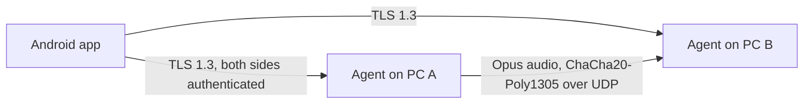

# ccontrol

**Control your Windows and Linux computers from your Android phone, on your own network.**

ccontrol is a local-first remote-control system. A small background agent runs on each
computer; the Android app pairs with it once, then reconnects securely whenever both are on
the same LAN or VPN. There is no cloud account, no relay server and no port forwarding.

[](https://github.com/qaxxorovxd/ccontrol/actions/workflows/ci.yml)
· **Downloads:** [Releases](https://github.com/qaxxorovxd/ccontrol/releases)

> **Project status — v0.3.0 (early, actively developed).** Pairing, device controls and audio
> routing with crash recovery work and are tested on Windows 10. The Linux agent is built and
> unit-tested but has not been run on a real Linux desktop yet, and the Android app has not yet
> been run on a physical phone. Notifications, the 3D workspace, remote keyboard/mouse, files,
> power and custom commands are **not built yet**. See [PROGRESS.md](PROGRESS.md) for exactly
> what was verified and how.

---

## Features

| Area | What you can do | Windows | Linux | Notes |
|---|---|---|---|---|
| Pairing | QR code, LAN discovery (mDNS) or manual IP; 6-digit code shown on both screens; owner approves on the computer and picks permissions | ✅ | 🟡 | Reconnects by cryptographic key, never by IP |
| Permissions | Grant/revoke each scope per phone (`media.control`, `audio.route`, `process.terminate`, …) | ✅ | 🟡 | Revoking disconnects the phone immediately |
| Sound | Master volume, mute, output device name | ✅ | 🟡 | PipeWire `wpctl` or PulseAudio `pactl` on Linux |
| Media | Now playing (title, artist, app, progress), play/pause, next, previous | ✅ | 🟡 | Windows media sessions / MPRIS on Linux |
| System | CPU, memory, disks, battery, uptime | ✅ | 🟡 | |
| Apps & processes | List open windows and close them; list processes and quit them (graceful first, force only after confirmation) | ✅ | 🟡 processes only | System-critical and other users' processes are protected |
| Audio routing | Send a computer's audio to another computer: Opus over encrypted UDP, ~50–80 ms measured on loopback, live loss/jitter/latency | ✅ whole output | 🟡 | Per-app audio needs Windows build 20348+ (Windows 11) or PipeWire |
| Recovery | Routes are journaled; if the phone disappears or an agent crashes, muted apps are restored automatically | ✅ | 🟡 | Never overrides a setting you changed yourself |

✅ verified on hardware · 🟡 implemented, not yet verified on that platform.
The full per-platform matrix (including what the OS does **not** allow) is in
[docs/os-capabilities/FEATURE_MATRIX.md](docs/os-capabilities/FEATURE_MATRIX.md).

## Download

Get the latest files from the **[Releases page](https://github.com/qaxxorovxd/ccontrol/releases)**:

| File | For |
|---|---|
| `ccontrol-Setup-x64.exe` | Windows 10 / 11 (x64) installer |
| `ccontrol-amd64.deb` | Debian, Ubuntu, Linux Mint |
| `ccontrol-x86_64.AppImage` | Most other x86_64 Linux distributions |
| `ccontrol-android-arm64.apk` | Android 10+ phones (works on every CPU type) |
| `SHA256SUMS` | Checksums for all files |

The packages are not code-signed yet: Windows SmartScreen and Android may warn before installing.

## Quick start

### 1. Install the agent on each computer

**Windows:** run `ccontrol-Setup-x64.exe`. No administrator rights are needed. Optionally tick
*Start at sign-in*. The installer starts the agent and opens its settings page. If Windows
Firewall asks, allow **Private networks** only.

**Debian / Ubuntu:**

```bash
sudo apt install ./ccontrol-amd64.deb
```

```bash
systemctl --user enable --now ccontrol-agent
```

**Other Linux (AppImage):**

```bash
chmod +x ccontrol-x86_64.AppImage && ./ccontrol-x86_64.AppImage
```

Open the settings page at any time with:

```bash
ccontrol-agent ui
```

The agent keeps running in the background when the settings page is closed.

### 2. Install the app on your phone

Install `ccontrol-android-arm64.apk` (allow installing from your browser or file manager when asked).
On Android 17+ the app asks for **Local network access**; allow it.

### 3. Pair

1. In the app tap **Add computer**, then either scan the QR code shown on the computer's
   settings page, pick the computer from the list, or type its IP address.
2. Check that the **same 6-digit code** is shown on the phone and on the computer.
3. On the computer click **Accept** and choose what this phone may do.

That's it. The phone remembers the computer and reconnects automatically, even if its IP changes.

### Route audio between two computers

Open **Audio** on the phone's dashboard, pick a source (an app, *Everything playing* or a
*Test tone*) on one computer and tap the destination computer. Choose the output device and
start. The route card shows latency, loss, jitter and level; **Stop and restore** ends it and
puts everything back the way it was.

## How it works



* **Identity:** every device has its own P-256 key (Android Keystore on the phone, DPAPI-protected
  on Windows). A device's ID is the SHA-256 of its public key.
* **Pairing:** commit/reveal 6-digit code plus explicit approval on the computer, so a
  man-in-the-middle cannot pair silently. See [Device pairing](docs/protocols/DEVICE_PAIRING.md).
* **Control protocol:** a closed, typed set of actions with no shell or free-form commands. Every
  request is checked against the phone's permissions. See [Control protocol](docs/protocols/CONTROL_PROTOCOL.md).
* **Network exposure:** one TLS port (47800) that accepts LAN/VPN addresses only, plus a settings
  page bound to `127.0.0.1` that requires a per-install token.
* **Audio:** the source agent owns each route: a state machine, a write-ahead journal and a
  lease. See [Audio routing](docs/architecture/AUDIO_ROUTING.md) and [Recovery](docs/architecture/RECOVERY.md).

More: [Architecture overview](docs/architecture/OVERVIEW.md) ·
[Threat model](docs/architecture/THREAT_MODEL.md) · [Privacy](docs/security/PRIVACY.md).

## Privacy

Everything stays on your network. ccontrol has no telemetry, analytics or cloud service. Audio
is never recorded. Logs contain no keys, tokens or message contents. Details:
[docs/security/PRIVACY.md](docs/security/PRIVACY.md).

## Build from source

| Part | Requirements |
|---|---|
| Desktop agent | Rust (stable), a C compiler and CMake (Windows: Visual Studio 2022 Build Tools with the C++ workload) |
| Android app | JDK 17+, Android SDK platform 37 |

```bash
cargo test --workspace
```

```bash
cargo build --release -p ccontrol-agent
```

```bash
cd android && ./gradlew :app:assembleDebug
```

Full instructions, packaging and test commands: [docs/developer/BUILD.md](docs/developer/BUILD.md).

## Repository layout

```text
crates/
  protocol/        typed, versioned control protocol (Rust)
  security/        device identity, TLS configuration, pairing code
  persistence/     SQLite trust store, audit log, route journal
  capabilities/    OS / session / capability detection
  system-control/  volume, media, telemetry, processes, windows
  audio-engine/    capture, Opus, encrypted UDP, jitter buffer, playback
  discovery/       mDNS advertisement
desktop/agent/     ccontrol-agent (background agent + settings page + CLI), ccontrol-ctl (developer controller)
android/           core (protocol, TLS, pairing, discovery, routes) and app (Jetpack Compose UI)
packaging/         Windows installer, .deb, AppImage, .rpm spec, Arch PKGBUILD, systemd user unit
docs/              architecture, protocols, capabilities, security, operations
```

## Troubleshooting

The phone can't find the computer? Is the firewall blocking it? Is the volume control
unavailable? See [docs/operations/TROUBLESHOOTING.md](docs/operations/TROUBLESHOOTING.md).

## Uninstall

* **Windows:** *Settings → Apps → ccontrol → Uninstall*. You can choose whether to also delete
  the device identity and pairings.
* **Debian/Ubuntu:**

```bash
systemctl --user disable --now ccontrol-agent; sudo apt remove ccontrol
```

* **Android:** uninstall the app as usual.

## Roadmap

1. Run on physical phones and on Wi-Fi; publish measured latency.
2. Per-app audio handoff on Windows 11 and Linux, verified on hardware.
3. 3D workspace: drag an app's audio from one computer model onto another.
4. Bidirectional notification sync.
5. Remote keyboard/mouse, files, services, power and safe custom commands.

## License

Dual-licensed under [MIT](LICENSE-MIT) or [Apache-2.0](LICENSE-APACHE), at your option.
