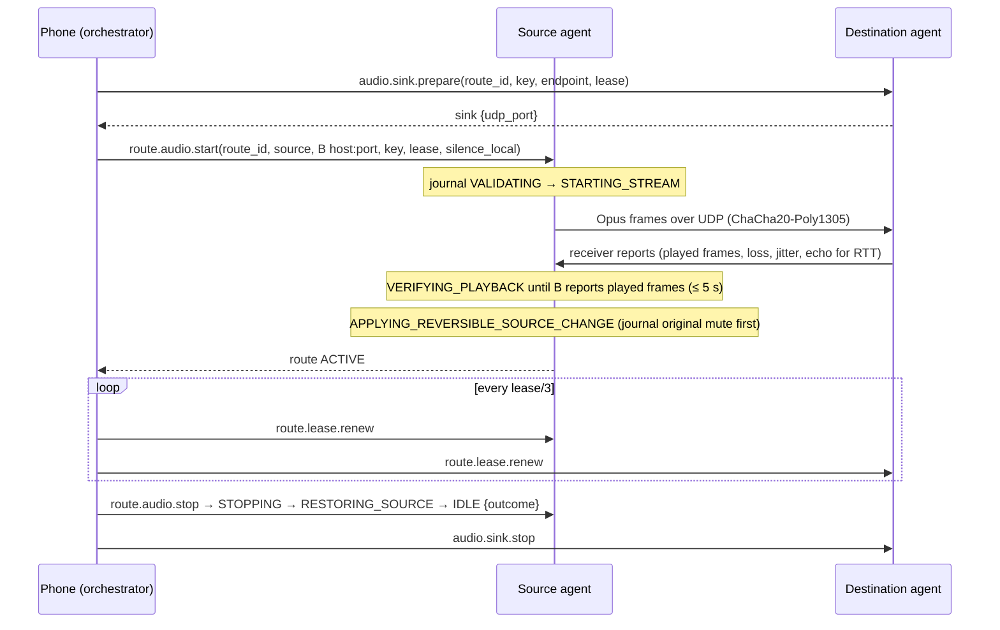

# Audio routing

Status (v0.3.0): **implemented.** Windows was verified on hardware with two agent processes
on one PC. Linux is implemented but has not run yet. A phone source or destination is not
implemented.

## Terms (kept distinct)
* **Session**: an OS audio session/stream belonging to an app (Windows `IAudioSessionControl2`
  with PID; PipeWire `Stream/Output/Audio` node with `application.process.id`).
* **Capture**: obtaining PCM: one app (*process*), the whole default output (*endpoint*), or a
  generated *test tone*.
* **Local silencing**: muting only that app's sessions on the source computer, reversibly, for a
  true handoff.
* **Remote playback**: rendering the received stream on a chosen output device of the destination.

## Topology

The phone does not carry audio. It creates a random per-route 32-byte key and gives it to
both agents over their mutually authenticated TLS channels. The agents never need to trust
each other directly: only holders of the key can produce packets the sink will accept.

## Platform implementation

| Source | Capture | Local silencing |
|---|---|---|
| Windows (any build) | Endpoint loopback (`AUDCLNT_STREAMFLAGS_LOOPBACK`, 48 kHz float via `AUTOCONVERTPCM`) ✅ | Not offered: whole-output capture includes local playback |
| Windows ≥ build 20348 | Process loopback (`ActivateAudioInterfaceAsync`, `PROCESS_LOOPBACK_MODE_INCLUDE_TARGET_PROCESS_TREE`) 🟡 compiled, not run (this PC is 19045) | `ISimpleAudioVolume::SetMute` on the app's sessions, with a **runtime safety check**: if the capture goes silent after muting, the agent unmutes again and keeps local playback |
| Windows < 20348 | Per-app capture refused with the reason; endpoint capture offered | — |
| Linux PipeWire | `pw-record --target <app node>` (per-app) or sink monitor (whole output) 🟡 not run | Not implemented yet: local playback kept, reason reported |
| Android | ⛔ arbitrary apps; `AudioPlaybackCapture` only for apps that opt in (not implemented) | ⛔ |

| Destination | Render |
|---|---|
| Windows | Shared-mode WASAPI on any active endpoint, 30 ms device buffer ✅ |
| Linux | `pw-play --target <sink>` 🟡 |
| Android | not implemented (planned: `AudioTrack` in a media foreground service) |

## Stream engine (`crates/audio-engine`)
* **Codec:** Opus (libopus via `opus`/`opusic-sys`), 48 kHz stereo, 10 ms frames, 128 kb/s,
  `LowDelay` mode, inband FEC with 5% expected loss.
* **Packets:** a 28-byte header (magic, kind, route tag, sequence, sender timestamp) used as
  AEAD associated data, then ChaCha20-Poly1305 ciphertext from `ring`. The nonce is
  kind‖seq, unique per direction. Receivers also apply a 64-packet sliding replay window.
  Unauthenticated packets are counted and dropped.
* **Jitter buffer:**
  - Prebuffers, then adapts its target to the RFC 3550 jitter estimate:
    `2 + ⌈2·jitter/10 ms⌉`, clamped to 20–120 ms.
  - A missing frame is recovered from the next packet's FEC, or else concealed with Opus PLC.
  - Duplicates and late packets are counted.
  - Drift control drops a frame when the queue exceeds target + 4.
  - After 200 ms of underrun it rebuffers.
* **Receiver reports** every 500 ms carry frames played, loss, jitter, buffer depth, output peak
  and an echo of the newest sender timestamp plus hold time. This gives a true network RTT without
  synchronized clocks. The latency estimate is `RTT/2 + jitter buffer + device buffer + 10 ms frame`.
* **Threads:** capture→encode→send, report receive, network receive, render. These are plain OS
  threads with no async code on the audio path.

## Measured (this PC, 2026-11-15)
Two agent processes on one Windows 10 19045 PC over loopback UDP. Source: Realtek default
output. Destination: USB speakers.

| Route | Time to ACTIVE (incl. playback verification) | Loss | Jitter | Est. one-way latency | Bitrate |
|---|---|---|---|---|---|
| Test tone → USB speakers | 548 ms | 0 / 474 frames | 0.01 ms | ~60 ms (40 ms buffer incl. 30 ms device) | 165 kb/s |
| Whole Realtek output (system sounds) → USB speakers | 553 ms | 0 / 668 frames | 0.01–0.02 ms | 50–80 ms | 37–125 kb/s (Opus VBR on silence) |

Captured and rendered peaks matched: tone 0.150 → 0.151, and the system-sound chimes at
0.15–0.21 were reproduced at 0.17–0.24. **No Wi-Fi measurement has been made yet**; the
numbers above exclude real network latency.

## Limits
* A route needs UDP reachability from source to destination on the LAN. The sink port is
  ephemeral, so a firewall that allows only the TCP control port blocks it. The installer's
  Windows firewall rule is program-scoped, so it allows both.
* Clock drift is handled by dropping or concealing frames, not by resampling. Very long routes
  between clocks that differ a lot may click occasionally.
