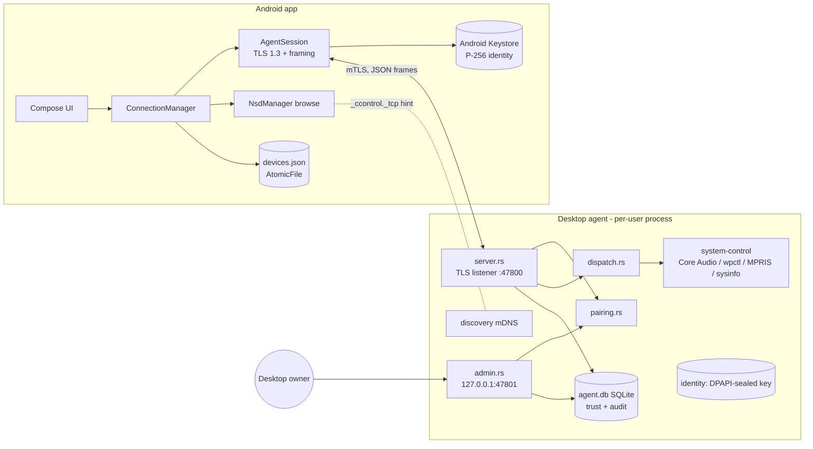

# Architecture overview

## Components

| Path | Responsibility |
|---|---|
| `crates/protocol` | Closed, versioned message set; 4-byte length + JSON framing; 1 MiB frame cap. |
| `crates/security` | Identity generation/persistence, rustls configs (client cert mandatory, SPKI pinning), commit/reveal SAS, DPAPI key sealing. |
| `crates/persistence` | SQLite trust store (controllers + scopes) and bounded audit log (WAL, `synchronous=FULL`). |
| `crates/capabilities` | Native OS/session detection, capability manifest with reasons. |
| `crates/system-control` | Platform adapters behind traits (`VolumeControl`, `MediaControl`, telemetry). |
| `crates/discovery` | DNS-SD advertisement. |
| `desktop/agent` | Binary: listener, session state machine, pairing approval, loopback settings UI, autostart, CLI. `ccontrol-ctl` is a developer controller using the same protocol. |
| `android/core` | Kotlin protocol mirror, Keystore identity, TLS factory with pinning, `AgentSession`, `PairingFlow`, `Discovery`, `ConnectionManager`, inventory. |
| `android/app` | Compose UI: dashboard, add/pair, device detail. |

## Key decisions (ADR summary)

1. **Per-user agent, not a service.** Core Audio, `SendInput`, D-Bus session bus and portals all
   require the interactive user session. A Session-0 Windows service cannot drive them. A small
   privileged helper is only added if a future feature truly needs it (e.g. power/WOL settings).
2. **TLS 1.3 with self-signed identities + pinning** instead of a custom secure channel. Android
   speaks it natively (Conscrypt) with Keystore-backed client keys; Rust uses rustls+ring. No custom
   crypto. Identity = `SHA-256(SPKI)` so it survives certificate re-issue and is independent of IP.
3. **Commit/reveal SAS** (6 digits) on both screens + mandatory owner approval on the desktop. A QR
   code additionally pins the server fingerprint before the handshake.
4. **JSON framing for Phase 1** (deviation from "Protobuf preferred"). Reason: no `protoc` in the
   build environment and AGP 9 + protobuf-gradle-plugin compatibility was unverified; a closed,
   test-pinned JSON schema (Rust tests and Kotlin `ProtocolTest` assert identical literals) keeps
   both sides honest. Migrating to Protobuf only changes `frame.rs`/`Framing.kt`.
5. **Settings UI is a loopback web page served by the agent** for Phase 1 (deviation from Tauri).
   It is ~5 MB smaller, has no WebView2/WebKitGTK dependency, and already provides pairing approval,
   revocation, capabilities and audit. A Tauri tray shell can wrap the same API later.
6. **Manual DI + JSON inventory on Android** for Phase 1 (deviation from Hilt/Room). The graph has
   three objects; the inventory is a handful of records written atomically with `AtomicFile`.
   Room becomes worthwhile with notification history and route journals.
7. **Foreground-only connections on Android.** `ConnectionManager` connects while the app is visible
   (ProcessLifecycleOwner) and drops sockets in the background, so the phone can sleep. Streaming
   features will add a typed foreground service when they exist.
8. **Trust re-checked on every request** (one indexed SQLite lookup): revocation and scope edits take
   effect immediately, and the revoking path also kicks live sessions with a `revoked` event.

## Data flow: a volume change

1. Slider → `ConnectionManager.call(id, VolumeSet(0.4))` → `AgentSession.request` assigns id, writes frame.
2. Agent session loop: dedupe id → reload controller from trust store → `dispatch::execute` checks scope
   `media.control`, validates range → `spawn_blocking` → `IAudioEndpointVolume::SetMasterVolumeLevelScalar`.
3. Agent reads back the real level/mute/endpoint name and responds; audit log records `volume.set ok`.
